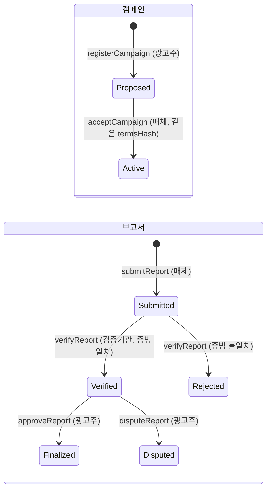
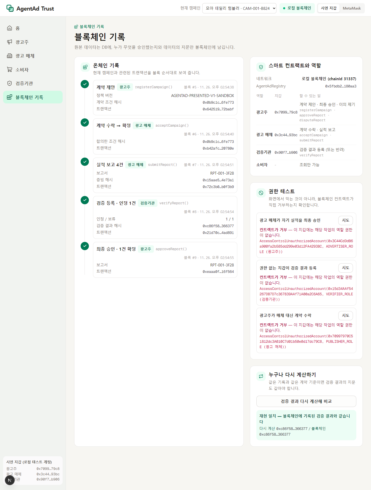

# 4-1. 스마트 컨트랙트와 검증 자료

> 제출 항목 4 · “소스·환경·주소, 검증 링크 또는 재현 자료, 테스트 결과”
> 기능 테스트의 항목별 기대 결과·실제 결과는 [4-2. 기능 테스트 결과](04-test-results.md)에 정리했습니다.

## 요약

| 항목 | 내용 |
| --- | --- |
| 컨트랙트 | `AgentAdRegistry` — [contracts/AgentAdRegistry.sol](../../contracts/AgentAdRegistry.sol) (275줄, MIT) |
| 역할 | 광고 집계 계약(정책 버전·계약 조건 해시) 제안·수락, 매체 보고 → 검증기관 검증 → 광고주 확정/이의 제기 이력 공동 기록 |
| 컴파일러 | solc **0.8.28** (`0.8.28+commit.7893614a`), optimizer **on, runs 200**, evmVersion **cancun** — [hardhat.config.ts](../../hardhat.config.ts) |
| 라이브러리 | OpenZeppelin Contracts **5.6.1** `AccessControl` |
| 개발 도구 | Hardhat **3.22** (`hardhat-toolbox-viem`), viem 2.x, 테스트는 `node:test` + viem |
| 배포 환경 | 로컬 Hardhat 노드 (chainId **31337**) — 시연·테스트 모두 실제 트랜잭션 |
| 소스 검증 | 로컬 체인은 공개 탐색기가 없어 Etherscan Verified 불가 → **배포 바이트코드 대조 스크립트로 재현** (`npm run chain:verify`, 결과 ✔ 일치) |
| 기능 테스트 | 컨트랙트 테스트 **20/20 통과**, E2E 중 블록체인 연동 항목 포함 **14/14 통과** |

## 1. 배포 환경과 주소

| 환경 | RPC | 컨트랙트 주소 | 비고 |
| --- | --- | --- | --- |
| E2E 테스트 (화면 캡처·로그 기준) | `http://127.0.0.1:8546` | `0x5fbdb2315678afecb367f032d93f642f64180aa3` | 새 노드에서 계정 #0의 첫 배포라 항상 같은 주소 (`deployments/e2e.json`) |
| 개발·시연 노드 (2026-11-26 대조 기준) | `http://127.0.0.1:8545` | `0x959922be3caee4b8cd9a407cc3ac1c251c2007b1` | `npm run demo:reset` 때마다 새로 배포되어 주소가 바뀜 (`deployments/localhost.json`) |
| 공개 테스트넷 Sepolia | — | **미배포** | 배포 스크립트·Etherscan 검증 명령은 준비됨 (아래 5절) |

역할 지갑 (로컬, Hardhat 공개 테스트 계정 — 실제 자산 없음)

| 역할 | 계정 | 주소 | 컨트랙트 권한 |
| --- | --- | --- | --- |
| 관리자(배포자) | #0 | `0xf39fd6e51aad88f6f4ce6ab8827279cfffb92266` | `DEFAULT_ADMIN_ROLE` (역할 부여만) |
| 광고주 | #1 | `0x70997970c51812dc3a010c7d01b50e0d17dc79c8` | `ADVERTISER_ROLE` |
| 광고 매체 | #2 | `0x3c44cdddb6a900fa2b585dd299e03d12fa4293bc` | `PUBLISHER_ROLE` |
| 검증기관 | #3 | `0x90f79bf6eb2c4f870365e785982e1f101e93b906` | `VERIFIER_ROLE` |
| 권한 없는 계정 (권한 테스트용) | #4 | `0x15d34aaf54267db7d7c367839aaf71a00a2c6a65` | 없음 |

**로컬 체인을 쓴 이유와 대체 근거**: 로컬 Hardhat 체인은 공개 블록 탐색기가 없어 Etherscan 소스 검증(Verified)을 받을 수 없습니다.
대신 현장 시연을 외부 네트워크·테스트 ETH·가스 상태와 무관하게 같은 결과로 재현할 수 있습니다.
가이드의 “로컬·검증 미지원 환경은 사유와 재현 자료로 확인”에 따라, 아래 2절의 바이트코드 대조와 4-2의 테스트 기록을 재현 자료로 제출합니다.

## 2. 소스코드 검증 — 배포 코드 일치 재현

[scripts/verify-local.ts](../../scripts/verify-local.ts)는 Etherscan Verified가 확인하는 것과 같은 질문(“배포된 코드가 공개 소스에서 나왔는가”)을 직접 대조합니다.

1. 저장소의 `contracts/AgentAdRegistry.sol` = 컴파일 입력(build-info)에 들어간 소스 (keccak256 비교)
2. 체인에 배포된 런타임 바이트코드(`eth_getCode`) = 그 소스를 위 설정으로 컴파일한 `deployedBytecode` (바이트 단위 비교)
3. `deployments/<network>.json`의 역할 지갑이 컨트랙트에서 실제로 해당 권한을 가짐 (`hasRole`)

실행 결과 ([evidence/verify-local.log](evidence/verify-local.log)):

```
AgentAdRegistry 배포 코드 일치 확인
  네트워크      localhost (RPC http://127.0.0.1:8545)
  컨트랙트 주소 0x959922be3caee4b8cd9a407cc3ac1c251c2007b1  (배포 블록 27)
  컴파일러      solc 0.8.28+commit.7893614a, optimizer on (runs 200), evmVersion cancun

  ✔ 저장소 소스 = 컴파일에 쓰인 소스 — keccak256 0x9a1bf007…aba55573
  ✔ 체인 ID 일치 — 31337
  ✔ 온체인 바이트코드 = 컴파일 결과(deployedBytecode) — 5847 bytes, keccak256 0xc393bfd1…1e648264
  ✔ 관리자 권한 — 0xf39fd6e51aad88f6f4ce6ab8827279cfffb92266
  ✔ advertiser 역할 권한 — 0x70997970c51812dc3a010c7d01b50e0d17dc79c8
  ✔ publisher 역할 권한 — 0x3c44cdddb6a900fa2b585dd299e03d12fa4293bc
  ✔ verifier 역할 권한 — 0x90f79bf6eb2c4f870365e785982e1f101e93b906

결과: 배포된 컨트랙트는 저장소의 소스를 위 설정으로 컴파일한 코드와 바이트 단위로 같습니다.
```

평가자 재현 방법: [MVP 실행 절차](02-mvp-guide.md#로컬-실행-절차-약-5분) ①~⑤ 후

```powershell
npm run chain:verify
```

> Verified 표시(또는 이 대조 결과)는 소스와 배포 코드가 같다는 뜻일 뿐, 보안 감사나 무결점 보증이 아닙니다.

## 3. 함수와 권한

| 함수 | 호출 가능자 | 동작 | 거부 조건 (custom error) |
| --- | --- | --- | --- |
| `registerCampaign(campaignId, policyId, policyHash, termsHash, publisher, verifier, start, end)` | `ADVERTISER_ROLE` | 계약 조건 제안 → `Proposed` | 권한 없음, 빈 값(`InvalidInput`), 기간 오류(`InvalidPeriod`), 이미 등록(`CampaignAlreadyRegistered`), 매체·검증기관 역할 아님(`InvalidParticipant`), 참여자 겹침(`PartiesNotIndependent`) |
| `acceptCampaign(campaignId, termsHash)` | 해당 캠페인의 매체 | 같은 조건 해시면 `Active` | 지정 매체 아님(`NotCampaignParticipant`), 상태 오류, 해시 불일치(`TermsMismatch`) |
| `submitReport(reportId, campaignId, reportedCount, evidenceHash)` | 해당 캠페인의 매체 | 보고 실적 + 증빙 해시 → `Submitted` | 계약 미확정, 같은 보고서 ID(`ReportAlreadyExists`), 사용 중인 증빙(`EvidenceAlreadyUsed`, 반려·이의 제기된 증빙만 재사용 가능) |
| `verifyReport(reportId, verifiedCount, heldCount, verificationHash, evidenceIntact)` | 해당 캠페인의 검증기관 | 인정·보류 건수 + 결과 해시 → `Verified` (증빙 불일치면 `Rejected`) | 지정 검증기관 아님, `Submitted` 아님(재검증 불가) |
| `approveReport(reportId)` | 해당 캠페인의 광고주 | → `Finalized` | 지정 광고주 아님, `Verified` 아님 |
| `disputeReport(reportId, reasonHash)` | 해당 캠페인의 광고주 | 사유 해시 기록 → `Disputed` | 빈 사유, 지정 광고주 아님, `Verified` 아님 |
| `getCampaign` · `getReport` · `evidenceUsedBy` | 누구나 | 조회 | — |

상태 전이



체인에는 **원본이 아니라 지문(해시)과 승인 상태만** 기록합니다: 계약 조건 해시(제안·수락), 증빙 해시(보고), 인정·보류 건수와 검증 결과 해시(검증), 확정·이의 제기.
컨트랙트는 원본 광고 기록이 사실인지 스스로 알 수 없으므로, 정책 엔진의 판정을 검증기관 지갑이 책임지고 제출하고 공동 승인 이력만 남깁니다.

## 4. 기능 테스트 요약

[tests/contract/AgentAdRegistry.test.ts](../../tests/contract/AgentAdRegistry.test.ts) — 20개 모두 통과 ([evidence/test-contract.log](evidence/test-contract.log)).

| 분류 | 테스트 수 | 확인 내용 | 결과 |
| --- | --- | --- | --- |
| 정상 처리 | 4 | 제안 → 수락 → 보고 → 검증(인정·보류 건수) → 확정, 이의 제기 사유 해시 기록 | 통과 |
| 권한 | 6 | 무권한 지갑의 제안·검증·승인·이의 제기 거부, 다른 캠페인 광고주 승인 거부, 미지정 지갑의 수락·보고 거부, 매체=검증기관 거부 | 통과 |
| 입력·상태 | 5 | 다른 조건 해시로 수락 거부, 재등록 거부, 수락 전 보고 거부, 미검증·반려 보고 승인 거부 | 통과 |
| 중복 요청 | 5 | 같은 보고서 ID 재제출 거부, 같은 증빙 이중 청구 거부, 재검증·재승인 거부, 반려·이의 제기 후 재제출 허용 | 통과 |

화면과 연결된 블록체인 동작은 E2E로 확인합니다: 계약 제안·수락, 보고, 검증 등록, 승인, 권한 테스트 3종(컨트랙트 revert), 증빙 변조 반려, 이의 제기 — [4-2](04-test-results.md#핵심-사용자-흐름-e2e).

서버는 브라우저가 보낸 트랜잭션 해시를 그대로 믿지 않고, 영수증의 컨트랙트 주소·이벤트·ID와 온체인 상태를 대조한 뒤 DB에 반영합니다 ([lib/blockchain/server.ts](../../lib/blockchain/server.ts) `confirmRegistryTx`).

## 5. 배포·실행 방법

**로컬 (제출 기준)**

```powershell
npm run setup
```

```powershell
npm run chain
```

```powershell
npm run chain:deploy
```

배포 스크립트 [scripts/deploy.ts](../../scripts/deploy.ts)는 컨트랙트를 배포하고 세 역할에 권한을 부여한 뒤 `deployments/<network>.json`에 주소·역할·배포 블록을 저장합니다. 웹 앱은 이 파일에서 주소를 읽습니다.

**Sepolia (준비만 됨, 미실행)** — 비밀키는 코드·`.env`에 넣지 않고 Hardhat 키스토어에 저장합니다.

```powershell
npx hardhat keystore set SEPOLIA_PRIVATE_KEY
```

```powershell
npx hardhat keystore set SEPOLIA_RPC_URL
```

```powershell
$env:ADVERTISER_ADDRESS="0x..."; $env:PUBLISHER_ADDRESS="0x..."; $env:VERIFIER_ADDRESS="0x..."; npm run chain:deploy:sepolia
```

```powershell
npx hardhat verify --network sepolia <컨트랙트주소> <배포자주소>
```

배포하면 아래 표를 채워 제출합니다.

| 항목 | 값 |
| --- | --- |
| Sepolia 컨트랙트 주소 | (배포 후 기입) |
| Etherscan Verified 링크 | `https://sepolia.etherscan.io/address/<주소>#code` |
| 시연 트랜잭션 예시 | (배포 후 기입) |

## 6. 동작 기록

E2E 실행(2026-11-26 14:54, 노드 8546)에서 하나의 캠페인이 거친 온체인 기록입니다. 블록체인 기록 화면이 컨트랙트 이벤트를 블록 순서대로 읽어 보여 줍니다.

| 블록 | 함수 | 서명 지갑 | 기록 내용 | 트랜잭션 |
| --- | --- | --- | --- | --- |
| #5 | `registerCampaign` | 광고주 | 정책 `AGENTAD-PRESENTED-V1-SANDBOX`, 계약 조건 해시 `0x0b9c1c…6fe773` | `0x642519…72babf` |
| #6 | `acceptCampaign` | 광고 매체 | 같은 조건 해시 `0x0b9c1c…6fe773`로 수락 → 확정 | `0xb42afc…20780e` |
| #7 | `submitReport` | 광고 매체 | 보고 4건, 증빙 해시 `0x15aae5…4e73a1` | `0x72c3b0…b0f3b9` |
| #8 | `verifyReport` | 검증기관 | 인정 1 / 보류 1, 검증 결과 해시 `0xc86f58…366377` | `0x21d70c…4ad891` |
| #9 | `approveReport` | 광고주 | 1건 확정 | `0xeaaa0f…16f564` |

같은 화면에서 권한 없는 시도 3종(매체의 자기 실적 승인, 무권한 지갑의 검증 등록, 광고주의 대리 수락)이 모두 `AccessControlUnauthorizedAccount`로 거부되고,
검증 결과를 다시 계산한 해시가 체인의 `0xc86f58…366377`과 일치(재현 일치)했습니다.



## 7. 한계

- 컨트랙트는 원본 광고 기록의 진위를 판단하지 않습니다. 보고 **이후**의 변조는 해시로 탐지하지만, 보고 **이전**에 매체가 기록을 조작하는 것은 막지 못합니다 (상용화 시 독립 측정 SDK 필요).
- 역할은 관리자가 부여합니다 (`DEFAULT_ADMIN_ROLE`). 다수 검증기관 합의나 관리자 권한 분산은 구현하지 않았습니다.
- 공개 테스트넷 배포와 Etherscan Verified는 아직 수행하지 않았습니다.
