# 7-1. 설계 — 구조도 · 사용 흐름 · 주요 화면

> 제출 항목 7 · “주요 화면·사용 흐름·구조도”
> 평가 기준 “기술 설계와 코드 관리(10점)”, “사용성과 디자인(5점)”의 근거 자료입니다. 화면 캡처는 모두 E2E 실행 중 실제 화면입니다.

## 1. 시스템 구조도

하나의 Next.js 앱이 화면과 API를 함께 제공하고, **원본 기록은 DB**, **합의·승인 이력과 지문(해시)은 블록체인**에 둡니다.
서명은 각 역할의 지갑이 브라우저에서 직접 하고, 서버는 트랜잭션 영수증을 체인에서 다시 읽어 확인한 뒤에만 DB에 반영합니다.

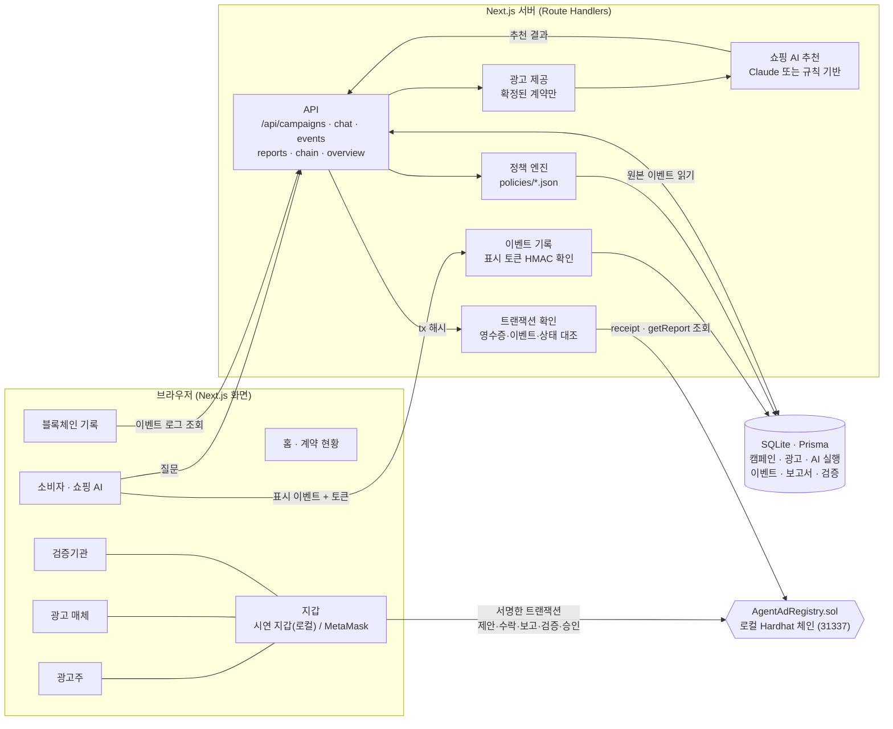

### 화면 · 지갑 · 계약 · 서버의 연결

| 단계 | 화면 | 서버 (API) | 지갑 서명 → 컨트랙트 | DB에 남는 것 |
| --- | --- | --- | --- | --- |
| 계약 제안 | 광고주 | `POST /api/campaigns` (계약 조건 원문·해시 생성) → `POST /api/campaigns/:id/chain` (tx 확인) | 광고주 → `registerCampaign` | 캠페인·광고 상품·계약 조건 원문 |
| 계약 수락 | 광고 매체 | `POST /api/campaigns/:id/chain` | 매체 → `acceptCampaign` | 계약 상태 `ACTIVE` |
| 광고 집행 | 소비자 | `POST /api/chat` (광고 제공·AI 추천·수신/추천 이벤트), `POST /api/events/display` (표시·가시성·미표시) | 없음 | AI 실행, 이벤트 5종 원본 + 이벤트 해시 |
| 실적 보고 | 광고 매체 | `POST /api/reports/submit` (증빙 목록 고정 + 증빙 해시) → `POST /api/reports/:id/chain` | 매체 → `submitReport` | 보고서·증빙 목록(manifest) |
| 검증 | 검증기관 | `POST /api/reports/verify` (정책 엔진 판정·결과 해시) → `POST /api/reports/:id/chain` | 검증기관 → `verifyReport` | 판정 결과·근거 |
| 승인·이의 | 광고주 | `POST /api/reports/:id/chain` | 광고주 → `approveReport` / `disputeReport` | 최종 상태·사유 원문 |
| 확인 | 블록체인 기록 | `GET /api/campaigns/:id/ledger`, `POST /api/reports/verify` (`mode: "reproduce"`) | 권한 테스트는 무권한 지갑으로 `simulateContract` → revert | — |

### 무엇을 어디에 두는가

| 데이터 | DB (원본) | 블록체인 (지문·상태) | 이유 |
| --- | --- | --- | --- |
| 계약 조건 (정책·참여자·기간·광고 제안) | 원문 JSON | `policyHash`, `termsHash`, 참여자 주소, 기간 | 집행 뒤 기준 변경 방지 — 양측이 같은 해시에 서명 |
| 광고 이벤트 (수신·추천·표시·가시성·미표시) | 원본 + 이벤트별 해시 | 보고 시점 증빙 목록의 해시 `evidenceHash` | 원본은 크고 개인 행동 데이터라 체인에 두지 않음. 보고 후 변조는 해시로 탐지 |
| 검증 결과 | 건별 판정·근거 | 인정·보류 건수, `verificationHash` | 누구나 같은 원본·정책으로 다시 계산해 비교 가능 |
| 승인·이의 제기 | 사유 원문 | 상태, `disputeReasonHash`, 서명 지갑·블록·시각 | 누가 언제 무엇을 승인했는지 공동 기록 |

## 2. 사용 흐름

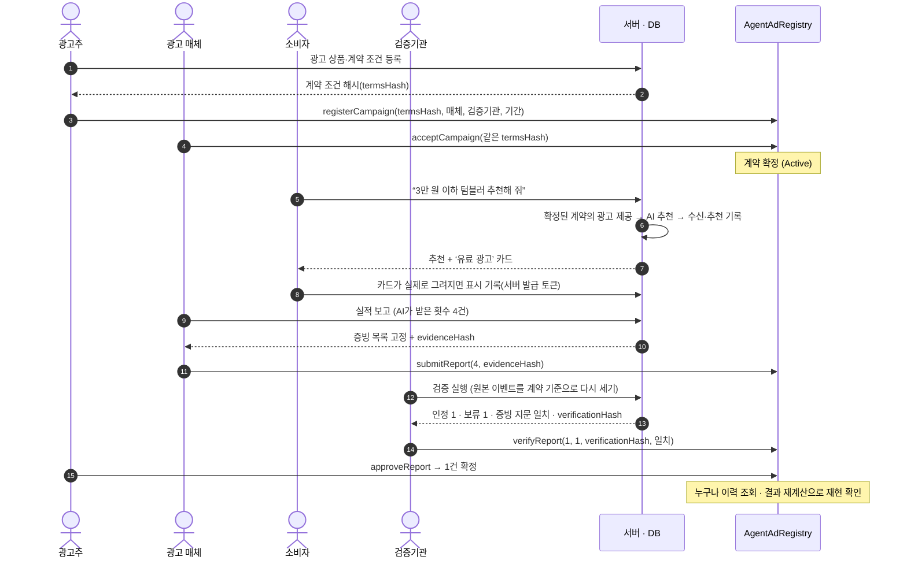

판정 기준 (정책 `AGENTAD-PRESENTED-V1`, 시연은 같은 조건의 샌드박스 버전)

| 이벤트 | 의미 | 정산 |
| --- | --- | --- |
| `AD_RECEIVED` | AI가 광고를 받음 (매체가 보고하는 ‘노출’) | 근거 아님 |
| `AD_RECOMMENDED` | AI 응답에 유료 광고가 구조적으로 연결됨 (offerId) | 근거 아님 |
| `AD_PRESENTED` | 소비자 화면에 광고 카드가 실제로 그려짐 + 화면 증빙 해시 | **정산 기준** |
| `AD_VIEWABLE` | 50% 이상 · 1초 이상 보임 | 보조 지표 |
| `AD_NOT_PRESENTED` | 추천됐지만 화면에 그리지 못했다고 보고 | 제외 |

광고 단위(`campaignId + offerId + responseId`)마다 **인정 · 제외 · 보류 · 중복**으로 판정합니다. 표시·미표시 기록이 모두 없으면 ‘미표시’가 아니라 **검증 불가(보류)** 로 남겨, 측정 오류를 매체 탓으로 돌리지 않습니다.

## 3. 주요 화면과 클릭 흐름

시연 순서대로 정리했습니다. 모든 화면 상단에는 현재 캠페인 선택, 체인 연결 상태(초록 ‘로컬 블록체인’), 서명 방식(시연 지갑 / MetaMask) 토글이 있습니다.

### ① 광고주 — 광고 등록과 계약 제안
`등록하고 계약 제안하기` 한 번으로 광고 상품 등록과 계약 제안 트랜잭션을 함께 처리합니다. 정산 기준(‘소비자 화면에 표시된 건만 인정’)과 광고 표기 문구를 계약 조건으로 먼저 보여 줍니다.

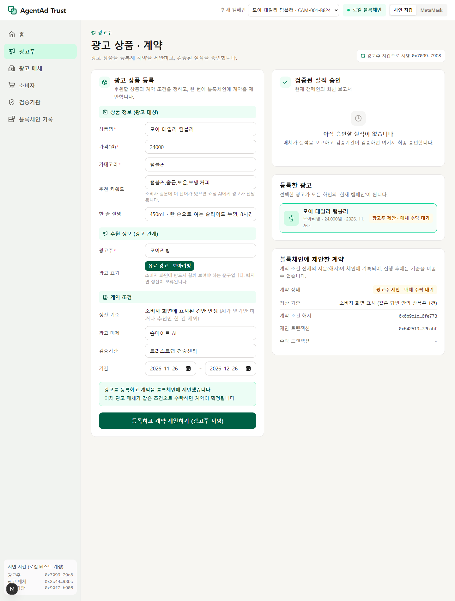

### ② 광고 매체 — 계약 수락
제안된 조건을 그대로 보여 주고 `같은 조건으로 수락`. 수락해야 AI가 이 광고를 받기 시작합니다.

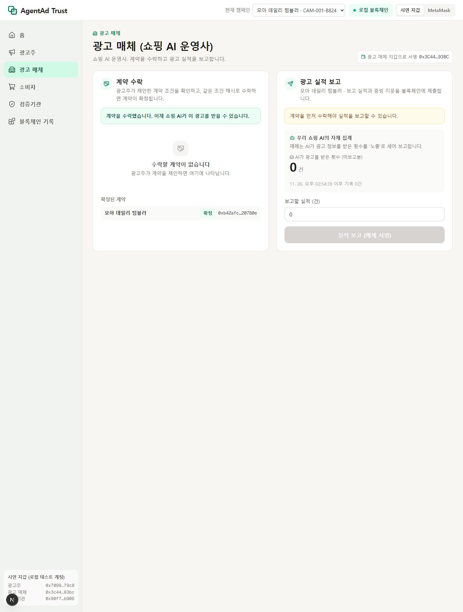

### ③ 소비자 — 쇼핑 AI
왼쪽은 소비자가 보는 채팅, 오른쪽은 발표용 시연 패널(시연 조건 · 추천 질문 · 광고 기록)입니다. 소비자에게는 ‘유료 광고 · 모아리빙’ 표기만 보이고 내부 ID는 보이지 않습니다.

| 정상: 수신 · 추천 · 표시 | 측정 오류: 카드는 보이지만 표시 기록 없음 |
| --- | --- |
| 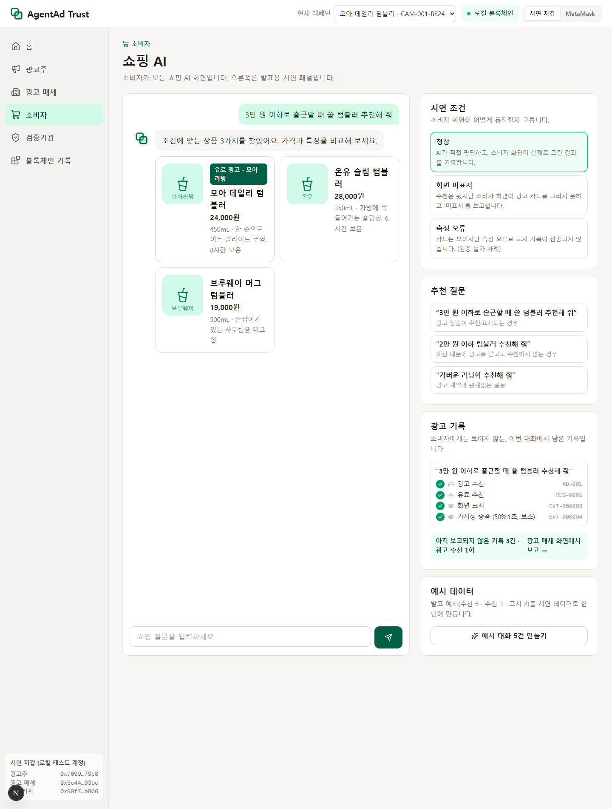 | 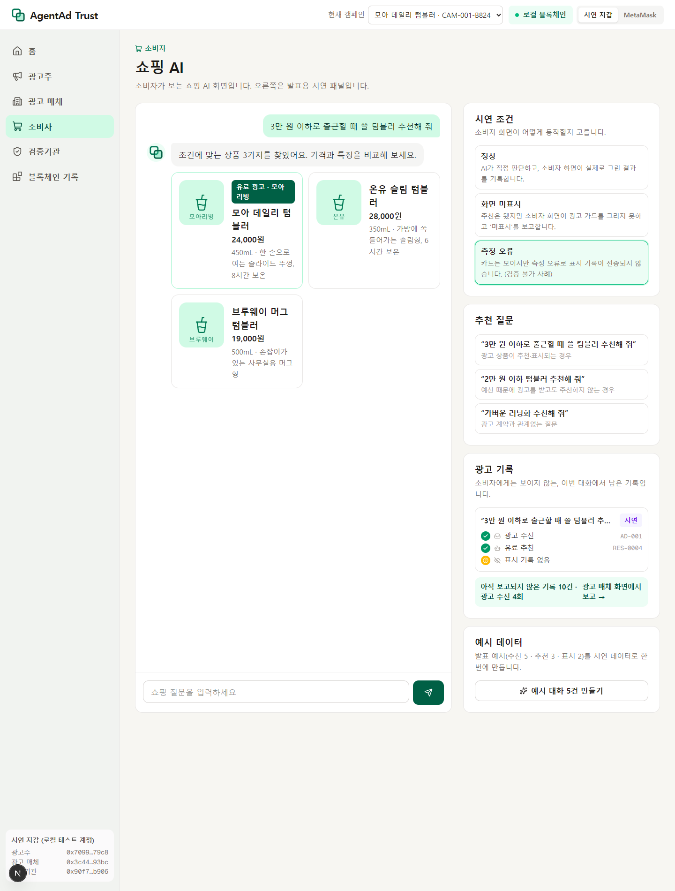 |

### ④ 광고 매체 — 실적 보고
‘AI가 광고를 받은 횟수’가 보고 수치로 미리 채워집니다. `실적 보고`를 누르면 증빙 목록이 고정되고 그 지문이 체인에 올라갑니다.

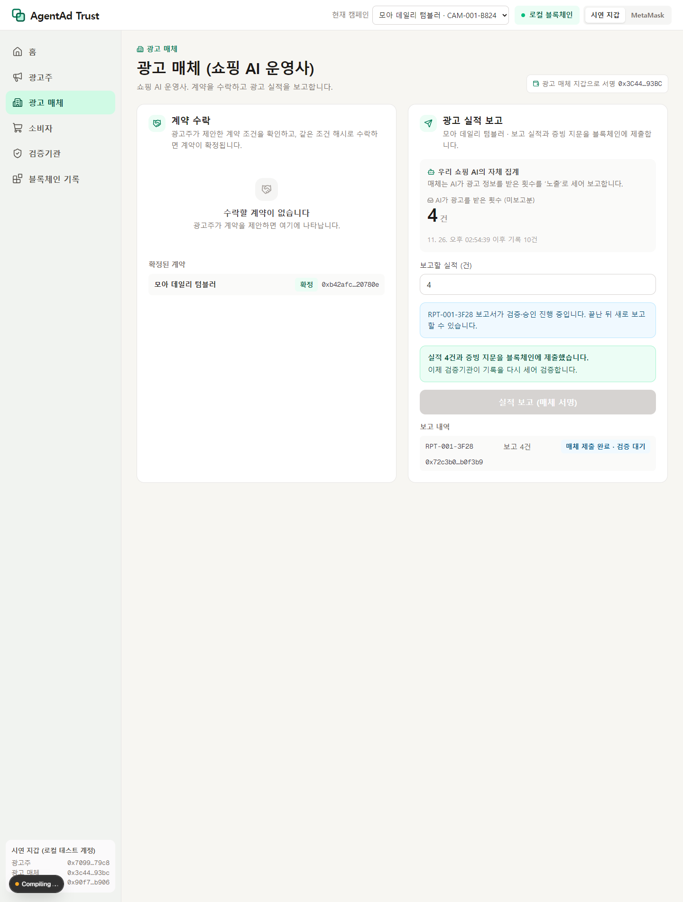

### ⑤ 검증기관 — 다시 세기
`검증 실행` → 매체 보고 4건 중 인정 1 · 보류 1, 차이의 이유를 막대로, 질문별로 ‘계약 광고 · 유료 추천 · 화면 표시 · 광고 표기’ 체크를 보여 줍니다. 오른쪽은 체인에 남은 증빙 지문과 지금 DB로 다시 만든 지문의 대조입니다.

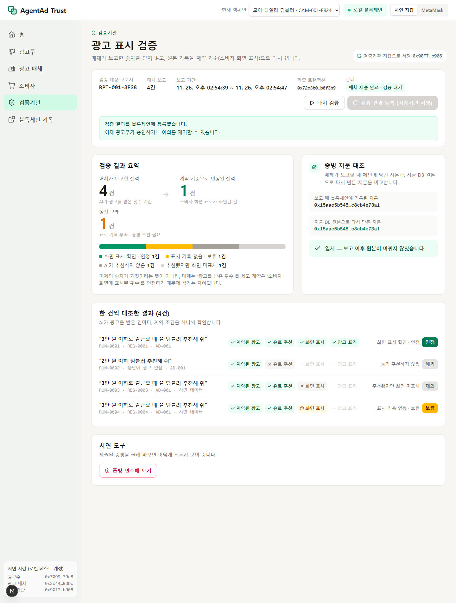

### ⑥ 홈 — 결과 정리
광고주가 승인하면 홈의 6단계가 모두 완료되고, 매체 보고(4) 대 인정 실적(1)이 이유별로 정리됩니다. 진행 중에는 ‘처리할 일 → 처리하기’로 다음 역할 화면에 바로 갑니다.

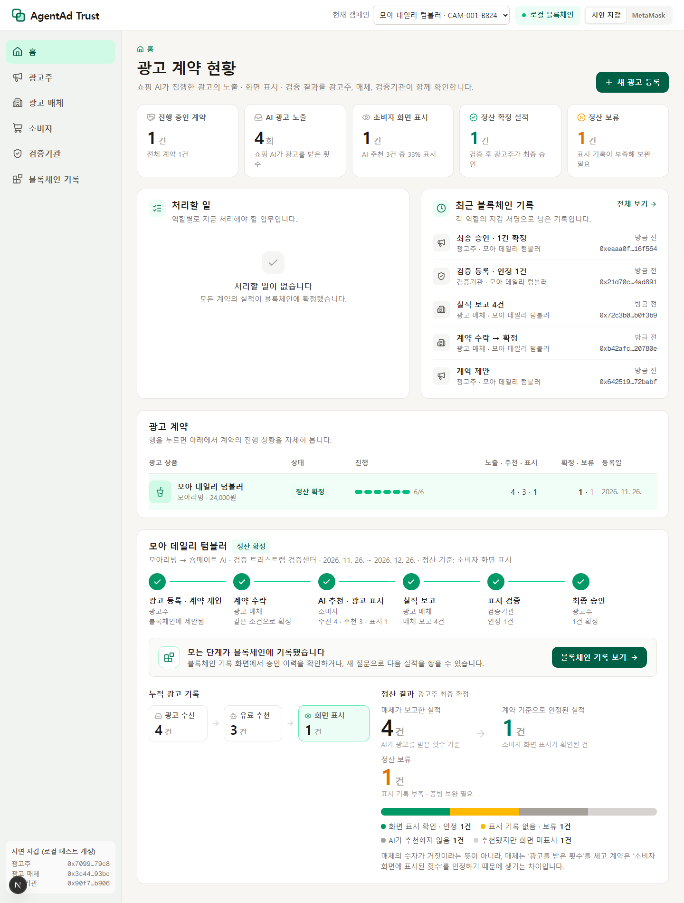

### ⑦ 블록체인 기록 — 신뢰의 근거
블록 순서대로 본 승인 이력 5건, 역할별 권한 표, 권한 테스트(컨트랙트가 직접 거부), 검증 결과 재계산(재현 일치).

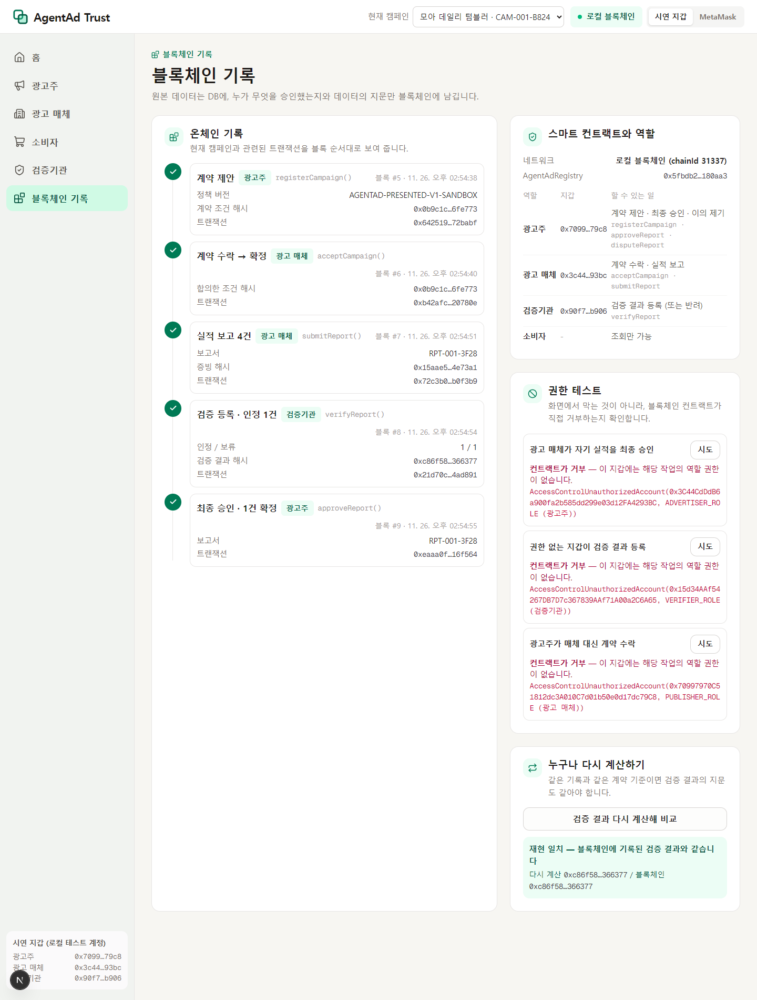

### ⑧ 예외 — 증빙 변조 반려와 이의 제기

| 변조 탐지 후 반려 → 홈 ‘매체가 다시 보고할 차례’ | 재보고 후 광고주 이의 제기 (사유 해시 기록) |
| --- | --- |
| 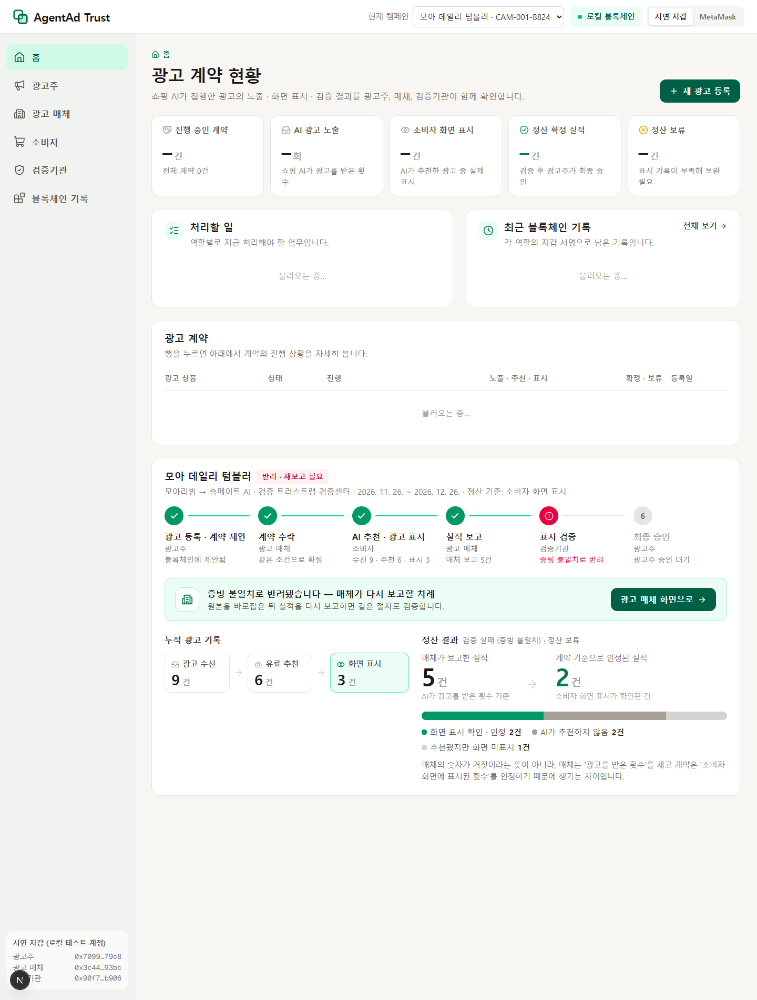 | 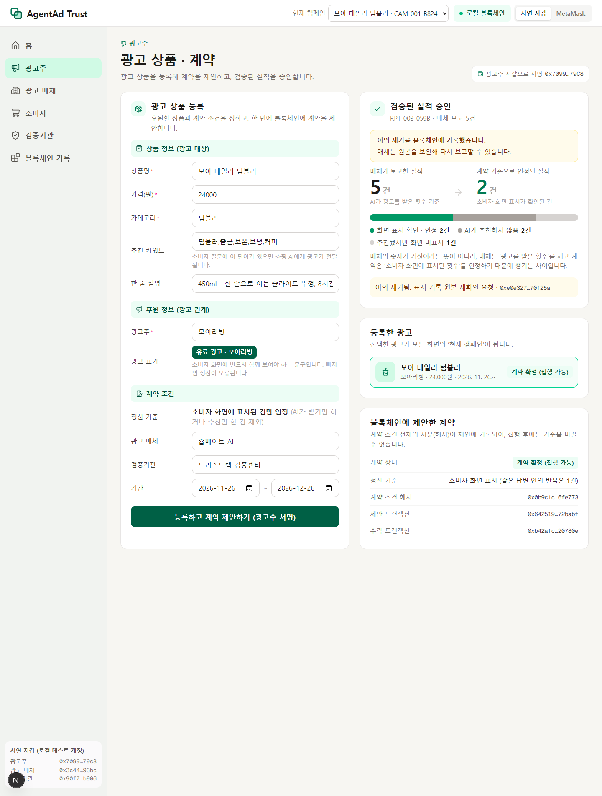 |

## 4. 사용성 설계와 피드백 반영

| 원칙 | 적용 |
| --- | --- |
| 역할별로 할 일만 보이기 | 정책·기술 설명 페이지를 없애고, 역할별 6개 화면에 그 역할의 버튼만 배치 (중간점검 이후 팀 결정: 정책 상세는 발표자료로 분리) |
| 다음 할 일 안내 | 홈 ‘처리할 일’과 6단계 진행판, 각 단계의 ‘처리하기’ 버튼, 소비자 화면의 ‘아직 보고되지 않은 기록 N건 → 광고 매체 화면에서 보고’ |
| 결과를 이유로 설명 | 숫자 차이를 “AI가 추천하지 않음 / 화면 미표시 / 표시 기록 없음(보류)”으로 나눠 막대와 문장으로 표시. “매체의 숫자가 거짓이라는 뜻이 아니라…” 안내 문구 |
| 쉬운 용어 | 해시 → ‘지문’, 트랜잭션 → ‘블록체인 기록’, INCONCLUSIVE → ‘정산 보류’ 등 화면 문구를 일상어로 |
| 실패도 결과로 보여 주기 | 권한 테스트의 revert 사유, 증빙 지문 불일치, 반려 상태를 화면에 그대로 표시 |
| 피드백 반영 | 팀 리허설 피드백 “글씨가 작아 잘 안 보임”, “홈을 실제 서비스처럼” → 전 화면 글자 약 2px 확대, 홈을 지표·처리할 일·최근 기록·계약 목록형 대시보드로 재구성 / “데이터가 이미 있어 시연이 안 됨” → `demo:reset`으로 빈 상태에서 시작 |

## 5. 코드 구조

```
app/                         화면(page.tsx) 6개 + api/ Route Handlers
components/                  역할별 *-view, app-shell, results(정산 결과), shopping/product-card(표시 측정)
lib/
  ai/  ads/  events/         쇼핑 AI, 광고 제공, 이벤트 기록·표시 토큰
  campaigns/  reports/       계약 조건·보고서 서비스
  verification/  policy/     정책 엔진(판정·해시·재현), 정책 로딩
  blockchain/                ABI, 서버 조회·tx 확인, 브라우저 서명(시연 지갑/MetaMask)
  core/canonical.ts          정렬된 JSON → keccak256 (모든 해시의 기준)
policies/                    집계 계약 정책 (데이터, 해시가 체인에 기록됨)
contracts/                   AgentAdRegistry.sol
scripts/                     deploy · export-abi · demo-reset · check-ai · verify-local
tests/                       verification(단위) · contract · e2e
```

자세한 API 목록과 폴더 설명은 저장소 [README](../../README.md#백엔드-api)에 있습니다.
